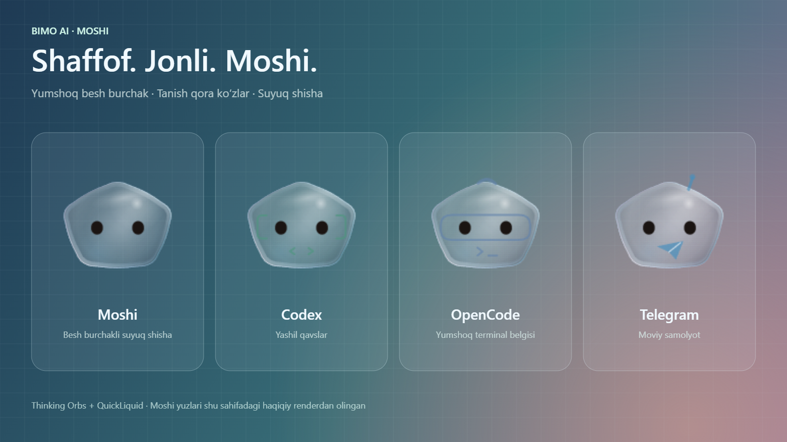

# Moshi: shaffof liquid glass va jonli holat orblari

Bu Windows o‘zgarishi mavjud Moshi, moslashuvchi panel, LocalAI Studio,
Telegram, ovozli boshqaruv va providerlarni saqlab, ularning ko‘rinishini boyitadi.
Liquid imkoniyatlari [BIMO AI 0.7.1 relizi](https://github.com/Ahmadjon0worker/BIMO-AI/releases/tag/v0.7.1) ichida ham mavjud.

**0.6.5 mahalliy o‘rnatildi:** 662 frontend va 306 Rust testi o‘tdi; EXE/MSI
payloadlari tekshirildi, sozlamalar va Telegram sessiyasi saqlandi.
[Tekshiruv hisoboti](VERIFICATION-0.6.5-UZ.md).



## Ishlatilgan manbalar

| Kutubxona | Qotirilgan revision | Litsenziya | Ishlatilgan qismi |
| --- | --- | --- | --- |
| [thinking-orbs](https://github.com/Jakubantalik/thinking-orbs) | `de85557ca220332586d070d8788c0e1d6e877a0d` | MIT, © 2026 Jakub Antalik | Canvas 2D geometriyasi, 9 holat, 20 va 64 px uchun alohida presetlar |
| [QuickLiquid](https://github.com/amarnath3003/quickLiquid) | `fbb19b5f1cd4097e62831da44df0bee0097433ca` | MIT, © 2026 Amarnath | Vanilla DOM `LiquidGlassEngine`, optik xaritalar, materiallar va analitik spring |

Manbalar `src/vendor/` ichida saqlangan; ikkala MIT litsenziya ham o‘sha yerda
qoldirilgan. React, qo‘shimcha npm kutubxonasi va tashqi tarmoqqa so‘rov kerak emas.

## Hozir ishlaydigan ko‘rinish

- Moshi besh burchakli, yumshoq shisha tanasiga ega; tanish yuz, ko‘zlar, holatlar
  va kiyimlar saqlangan. Agentlarning ranglari va belgilariga mos shisha ishlatiladi.
- Panel, Studio, Telegram/CMD/PowerShell vositalari va sozlamalar bitta material
  tizimida: shaffof fon, qirra nuri, nozik rang ajralishi va o‘qilishi qulay matn.
- QuickLiquid haqiqiy SVG displacement xaritasi orqali **WebView ichidagi** fonni
  egadi. RGB kanallari qirralarda biroz farqli siljiydi. Yorug‘lik kursor joyiga
  moslashadi; bu faqat bezak qatlamiga ta’sir qiladi.
- Orblar AI javobi, agent ishlashi, Telegram ulanishi va ovozli jarayon holatini
  jonlantiradi. Kutubxonadagi `working`, `searching`, `solving`, `listening`,
  `connecting`, `weaving`, `composing`, `breathing`, `shaping` holatlari mavjud.
- Tugmalarning bosilish javobi upstream analitik spring bilan CSS `scale` orqali
  hisoblanadi. Panelning drag/dock `transform` qiymati almashtirilmaydi.

Windows oynalari shaffof WebView sifatida ochiladi, shuning uchun ish stoli fonini
ko‘rish mumkin. **Brauzer SVG/backdrop filtri oynaning tashqarisidagi ish stolini
suratga olib egmaydi yoki xiralashtirmaydi.** Ish stoli tasviri olinmaydi; native
DWM acrylic/mica bu o‘zgarishda qo‘shilmagan. To‘liq optik sinish WebView ichidagi
kontentda tekshiriladi. Mikrofon va Telegram imkoniyatlari avvalgi xizmatlar orqali
ishlaydi; bu vizual qatlam ularga yangi ruxsat qo‘shmaydi.

## Tezlik va moslashuv

`installLiquidSurfaces(root, scope)` mavjud elementlarning ichiga faqat bo‘sh,
bosishni ushlamaydigan bezak qatlamini qo‘shadi. Mavjud bolalar ko‘chirilmaydi,
flex/grid tuzilmasi, o‘lchamlar va hit area saqlanadi.

Haqiqiy optika ko‘rinib turgan yirik yuzalargagina ajratiladi: bitta scope’da eng
ko‘pi 12 ta. Mayda tugmalar va chat qatorlarida alohida optical map yaratilmaydi.
Bir xil geometriyadagi xaritalar upstream reference-counted cache orqali bo‘lishiladi.
Panel kengayayotganda yangi raster har kadrda yaratilmaydi: o‘lcham 90 ms tinigach
yangilanadi. Kursor nuri va bosilish faqat harakat vaqtida animatsiya kadri ishlatadi.

Yashirin yoki ekrandan chiqib ketgan yuzalar optik xaritalarni bo‘shatadi; oynani
yo‘q qilish observer/listener/RAF resurslarini tozalaydi. Orblar bitta umumiy soat
va RAF orqali ishlaydi. `prefers-reduced-motion` animatsiyalarni kamaytiradi,
`prefers-reduced-transparency` esa o‘qilishi qulay yaxlit fonni tanlaydi.
Canvas/SVG imkoniyati bo‘lmasa oddiy CSS glass ko‘rinishi ishlashda davom etadi.

## Tekshirish

```powershell
npm exec tsc -- --noEmit
node --import ./tests/setup.mjs --test ./tests/liquid-surfaces.test.mjs ./tests/thinking-orb.test.mjs
npm exec vite -- --host 127.0.0.1 --port 1420 --strictPort
```

Ko‘rinish: `http://127.0.0.1:1420/tests/fixtures/liquid-preview.html`.
Preview’da to‘q/yorug‘ fon, agentlar, gorizontal/vertikal/burchak panel shakllari va
holat animatsiyalari bor. Canvas PNG eksporti hamrohlar ko‘rinishini saqlaydi;
SVG backdrop sinishini alohida brauzer screenshotida ko‘rish kerak.

Focused testlar yashirin/offscreen/reduced-transparency resurs tozalashini,
bosilish RAF’ini, mavjud DOM va drag transform saqlanishini, optik xaritaning tiniq
markazi va simmetrik qirra sinishini tekshiradi. Native Windows ish stolining
ko‘rinishi o‘rnatilgan ilovada ko‘z bilan tekshiriladi; browser preview uning to‘liq
o‘rnini bosa olmaydi.
