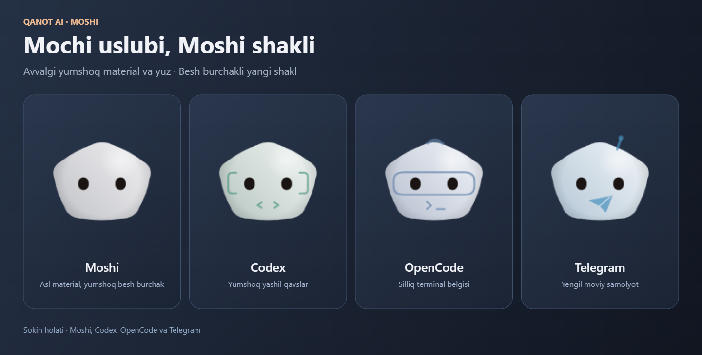

# Qanot AI for Windows — 0.6.4

Qanot AI combines a movable desktop panel, **LocalAI Studio**, Telegram, CMD/PowerShell, GitHub tools and local Uzbek voice control. **Moshi** adapts the original **Mochi** design to a soft pentagonal body, retaining its white-gray materials, black eyes, shadows and clothing. Telegram, Codex, OpenCode and other agent variants share this family, with color variants for subagents. This Windows edition derives from [Louis-CFM/coucou](https://github.com/Louis-CFM/coucou); Qanot product branding, icons and notification cues remain unchanged.



This still frame comes from the shipping renderer. Moshi breathes, blinks, waves and animates according to agent state. Renderer source code retains the [MIT license](../LICENSE). The Mochi-based character and preview retain the [original artwork terms](../LICENSE-ASSETS.md); the user confirmed written permission to distribute the adaptation.

## Download and open

The 0.6.4 source and installers passed local validation. Uploaded GitHub assets, their exact source commit and SHA256 digests are checked separately by the publisher and read-only verifier after upload.

- [QanotAI-Windows-0.6.4-setup.exe](https://github.com/Ahmadjon0worker/CouCou-Uzbek-edition-/releases/download/v0.6.4/QanotAI-Windows-0.6.4-setup.exe): the recommended current-user installer.
- [QanotAI-Windows-0.6.4.msi](https://github.com/Ahmadjon0worker/CouCou-Uzbek-edition-/releases/download/v0.6.4/QanotAI-Windows-0.6.4.msi): Windows Installer format.
- [Release notes and checksums](https://github.com/Ahmadjon0worker/CouCou-Uzbek-edition-/releases/tag/v0.6.4).

Windows 10/11 x64 and WebView2 are required. The installer contains an isolated Python runtime, GitHub CLI and the offline voice components. Python, Node.js and Rust are not required on the destination PC. WebView2 installation may need internet. Ollama and large chat models are installed separately.

Use **Qanot AI LocalAI Studio** in Start or the tray menu. The compatible executable command remains `coucou.exe --studio`. Closing Studio hides it; **Quit** stops the app and its owned local service.

The service listens on loopback only, using port 11435 or 11437. An incompatible service already using 11435 is preserved. Studio's system status explains startup errors.

## Use the panel and tools

Drag the **⠿** handle. The compact panel is horizontal at the top/bottom, vertical at a side and square in a corner. Placement follows the Windows work area and is saved. The **−** button folds an expanded panel; waiting permission requests remain pending. General settings provide nine placements, hover opening, sounds, colors and shortcuts.

Select Ollama, Gemini, Groq or Auto in Studio. Auto tries Ollama, then configured Gemini and Groq. Provider keys use Windows Credential Manager. Cloud tasks send their relevant text to the chosen provider; local voice needs no provider key.

Telegram supports personal-account login, chat search/filter/pages, history, Saved Messages, username resolution, messages/replies and AI drafts. An explicit send instruction or send button authorizes one message. Uncertain sends are not automatically repeated. There are no background replies to every chat.

Manual CMD/PowerShell, GitHub and window-bound desktop actions work without a chat model. Terminal scripts run with the current user's permissions; the workspace restriction is not an OS sandbox. AI proposes work for review. Desktop sessions require a current observation and exclude protected credential/payment/shell windows.

Open **Voice control**, then click **Speak**. Uzbek selects NavAI Whisper small Q5_1 with Silero VAD; English/Russian select multilingual small-q5_1. eSpeak supplies local speech. Optional continuous listening accepts **OK Moshi**; **OK Qanot**, **OK Coucou** and **OK Kuku** remain compatible. The microphone does not open at startup, and recordings are temporary.

## Existing data stays compatible

The new default installation folder is `%LOCALAPPDATA%\Qanot AI`. Existing per-user data retains `%APPDATA%\Coucou\settings.json` and `%LOCALAPPDATA%\Coucou\LocalAI`. Credential targets, service protocol IDs and compatible `coucou.exe`, `coucou-hook.exe`, `coucou.cmd`/`coucou.ps1` names are intentionally retained. Do not rename these internal paths. This preserves panel/provider settings and the existing Telegram session.

## Guides and validation

- [Complete edition guide and build steps](../README.md)
- [Uzbek installation guide](INSTALL-UZ.md)
- [Uzbek feature guide](README-UZ.md)
- [Telegram, terminal, GitHub and MCP](localai-service/TOOLS-UZ.md)
- [Local voice and limitations](localai-service/VOICE-UZ.md)
- [Runtime bootstrap](scripts/RUNTIME-BOOTSTRAP.md)

Current 0.6.4 validation passed 651 frontend and 306 Rust tests, TypeScript/Vite/native builds, both installer extraction/hash checks and an actual EXE upgrade preserving settings and the encrypted Telegram session; see [the verification record](VERIFICATION-0.6.4-UZ.md). The frozen runtime retains the historical 0.6.3 service/voice evidence, which does not verify the new native/frontend package. The human microphone/room test, MSI installation and clean-VM test remain pending.

## Build from source

Use Windows x64, Python 3.12+, Node.js 24, Rust MSVC and C++ Build Tools. From `windows`:

```powershell
py -3.12 scripts/prepare-release-runtime.py --download
npm ci
npm test
node scripts/build-hook.mjs
cargo test --workspace --locked
npm run pack
```

The helper obtains the fixed [unchanged 0.6.3 runtime archive hosted by release v0.6.4](https://github.com/Ahmadjon0worker/CouCou-Uzbek-edition-/releases/download/v0.6.4/QanotAI-Windows-0.6.3-runtime.zip), verifies its ZIP/manifest and all file hashes, then synchronizes the current service source. Large runtime/model binaries and all personal data are excluded from Git. `npm run pack` checks source/runtime freshness and produces EXE/MSI plus checksums in `release`.

For a private repository, download the ZIP with your signed-in GitHub account first, then run `py -3.12 scripts/prepare-release-runtime.py --archive C:/Downloads/QanotAI-Windows-0.6.3-runtime.zip`. The helper's `--download` request is unauthenticated and does not read tokens/browser credentials.

The source retains the upstream MIT attribution. Mochi-based Moshi materials, eyes and clothing are adaptations of Louis Raillé's artwork, governed separately by [LICENSE-ASSETS.md](../LICENSE-ASSETS.md) and the written permission confirmed by the user. Moshi is not presented as independent original artwork. Qanot icons and notification cues retain their separate MIT asset license. See the voice guide for model/eSpeak licenses and corresponding source distribution.
